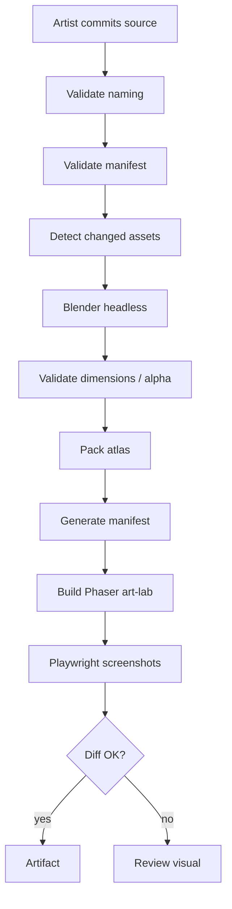

# Art Pipeline Specification — Landlord

> Versión: 0.1
>
> Estado: propuesta técnica de preproducción.
>
> Objetivo: convertir una fuente artística editable en un asset web reproducible, validado, versionado y cargable por Phaser.

## Principio

El primer entregable importante del pipeline no es un asset aislado de alta calidad: es una cadena reproducible que permita modificar un asset fuente y regenerar correctamente render, recorte, atlas, metadata, integración y validación.

## Baseline propuesto

```text
concept / Art Bible
-> Blender source
-> model / UV / materials / rig
-> validation
-> canonical camera + lighting
-> headless render
-> RGBA master frames
-> trim / validation
-> atlas packing
-> asset manifest
-> Phaser
-> visual regression
```

La versión exacta de Blender, la herramienta de packing y las políticas LFS deben congelarse sólo después de validar el spike.

## Pipeline técnico de Blender a sprites

El pipeline propuesto no consiste simplemente en pulsar “Render” en Blender. Debe ser una transformación reproducible desde fuente artística hasta recurso del navegador.

```mermaid
flowchart LR
    A[Concept / Art Bible] --> B[Blender source]
    B --> C[Modelado y UV]
    C --> D[Substance / materiales]
    D --> E[Rig y animación]
    E --> F[Scene validation]
    F --> G[Canonical camera + lighting]
    G --> H[Blender headless render]
    H --> I[RGBA master frames]
    I --> J[Post / trim / validation]
    J --> K[TexturePacker]
    K --> L[Atlas + metadata]
    L --> M[Asset manifest]
    M --> N[Phaser]
    N --> O[Visual regression]
    O --> P[Build / CDN]
```



Blender está especialmente bien adaptado a esto porque soporta render sin interfaz gráfica y ejecución por línea de comandos; su documentación oficial contempla expresamente la automatización y renderizado remoto/headless. `blender -b file.blend -f 10` procesa un frame sin interfaz y `-a` puede procesar una animación completa.

**Versionado**

No utilizaría “Blender latest” en producción.

Usaría:

```text
tools/versions.json

{
  "blender": "4.5.x-LTS",
  "texturePacker": "...",
  "aseprite": "...",
  "assetSchema": 1
}
```

La versión exacta debe quedar fijada una vez validado el primer vertical slice.

**Plantilla de escena Blender**

Todos los assets se basarán en:

```text
templates/
    building.blend
    character.blend
    prop.blend
    vehicle.blend
```

Cada plantilla incluye:

```text
COL_CAMERA
COL_LIGHTING
COL_REFERENCE
COL_RENDER
COL_COLLISION_HELPERS
COL_ANCHORS
```

Y objetos reservados:

```text
CAM_GAME
LIGHT_KEY
LIGHT_FILL
ANCHOR_ROOT
FOOTPRINT
HEIGHT_GUIDE
```

**Sistema de unidades**

Propuesta:

```text
1 Blender unit = 1 metro
1 Landlord cell = 4 × 4 metros
```

El tamaño concreto de una celda física puede ajustarse durante el Visual Direction Spike, pero una vez aprobado debe convertirse en constante del proyecto. Lo importante es que **ningún artista escale a ojo para que “quede bien en pantalla”**.

**Cámara**

```text
projection      ORTHOGRAPHIC
azimuth         45°
elevation       ~30°
roll            0°
camera shift    0
```

El `orthographic_scale` se calcula a partir de footprint y output resolution.

No se permitirá perspectiva en assets del mundo.

**Iluminación canónica**

La iluminación queda fijada en la Art Bible:

```text
             KEY/SUN
                ↘
              CITY

camera → ◇
```

Propuesta:

- key solar desde el cuadrante noroeste de pantalla;
- sombras hacia sureste;
- fill ambiental suave;
- temperatura ligeramente cálida;
- ambient occlusion discreto;
- ningún punto completamente negro;
- highlights controlados;
- fondo transparente.

La razón es estructural: una vez horneada la iluminación dentro del sprite no podemos mover el sol dinámicamente sin revelar que los edificios no están iluminados igual.

Por ello **Landlord v1 no debería tener ciclo completo de día/noche con luz físicamente móvil**.

Puede tener:

```text
día
lluvia
niebla
noche estilizada
```

mediante variantes, lightmaps/overlays, ventanas iluminadas, partículas y grading.

Un verdadero ciclo solar requeriría renders por dirección/estado o migrar parte de la iluminación al runtime, y debe considerarse una feature independiente.

**Motor de render**

Mi baseline sería **EEVEE**. Blender lo define como su motor de render en tiempo real centrado en velocidad e interactividad y compatible con materiales PBR, lo que encaja mejor con cientos o miles de renders automatizados que Cycles.

Cycles se reserva para:

- renders de referencia;
- comprobar materiales;
- hero images;
- marketing;
- detectar desviaciones de EEVEE.

**Texturizado**

El pipeline PBR interno puede trabajar con:

```text
BaseColor
Roughness
Metallic
Normal
AO
Emission
```

aunque al final se convierta en un único sprite RGBA.

Esto es muy útil: permite crear materiales reutilizables como:

```text
mat_brick_red_01
mat_brick_dirty_01
mat_plaster_warm_01
mat_steel_painted_01
mat_brass_01
mat_asphalt_01
mat_wood_dark_01
```

Substance 3D Painter permite definir Output Templates que controlan nomenclatura, channel packing, formato y profundidad de salida, y soporta, entre otros, PNG y WebP. Adobe también incluye un preset orientado a Blender/Principled BSDF.

No obstante, **Substance no debe ser obligatorio para contribuir al proyecto**. Un colaborador debería poder crear un asset completamente válido con Blender.

**Formato fuente**

Jerarquía recomendada:

```text
authoritative:
    .blend

optional texturing source:
    .spp
    .psd
    .kra

interchange:
    .glb

render master:
    .png / .exr

runtime:
    .png
    atlas metadata
```

No utilizaría glTF como formato artístico canónico. Blender puede exportar escenas, materiales, animación y propiedades personalizadas a glTF/GLB, pero determinadas características propias de Blender necesitan extensiones y no todo el grafo de trabajo constituye una representación perfecta del `.blend`. GLB debe ser **intercambio**, no “master source”.

**Salida de render**

Para vertical slice:

```text
Master:
PNG RGBA 16-bit
transparent background

Runtime:
PNG RGBA 8-bit
```

PNG soporta alfa y Blender puede trabajar con PNG de 8/16 bits; utilizar 16 bit en el master deja margen de grading antes de reducir a 8 bits.

OpenEXR tiene sentido si el proyecto necesita pases o composición HDR compleja, pero introducirlo obligatoriamente desde el principio añade fricción innecesaria.

**PNG, WebP y AVIF**

La política recomendada es:

| Uso | Formato |
|---|---|
| master sprite | PNG 16 bit |
| atlas baseline | PNG 8 bit |
| fondos grandes UI | WebP |
| splash/marketing | AVIF + WebP fallback |
| iconografía | SVG cuando sea DOM |
| texturas GPU futura | KTX/PVR según soporte |

Phaser acepta imágenes que pueda presentar el navegador y soporta spritesheets, atlas y multiatlas; también dispone de carga de texturas GPU comprimidas con fallback a imágenes convencionales.

WebP y AVIF aportan opciones modernas de compresión web, mientras PNG sigue proporcionando compresión lossless y alfa completo. Para Landlord empezaría con PNG en atlases y cambiaría únicamente después de benchmark, no por anticipación.

**Naming convention**

Todo en ASCII, `lower_snake_case`, sin espacios.

Tipos:

```text
bld_  building
chr_  character
veh_  vehicle
prp_  prop
ter_  terrain
vfx_  effect
ui_   interface
ico_  icon
snd_  sound
mus_  music
```

Edificio:

```text
bld_res_rowhouse_a_r0_complete
bld_res_rowhouse_a_r0_build_25
bld_res_rowhouse_a_r0_build_50
bld_res_rowhouse_a_r0_damaged
```

Personaje:

```text
chr_worker_m01_idle_ne_f000
chr_worker_m01_walk_ne_f000
chr_worker_m01_walk_ne_f001
```

Terreno:

```text
ter_asphalt_clean_a
ter_grass_dry_a
ter_road_straight_ne_sw
```

No colocaría `v001`, `final`, `final2`, etc. en IDs runtime.

La versión pertenece a Git y al manifest.

**Anchor**

Esta es una de las especificaciones más importantes.

No se debe fijar manualmente un pivot “aproximadamente en los pies”.

El `.blend` contiene:

```text
ANCHOR_ROOT
```

El script proyecta ese punto con la cámara oficial y escribe el resultado en metadata.

En personajes:

```text
ANCHOR_ROOT = midpoint between feet on ground
```

En edificios:

```text
ANCHOR_ROOT = footprint origin / ground plane
```

De esta manera, trim y atlas packing no rompen posicionamiento.

**Trim**

TexturePacker puede eliminar transparencias manteniendo información de tamaño original, aplicar márgenes y extruir píxeles de borde para evitar seams al escalar o muestrear entre texels. También soporta multipack y pivots.

Configuración inicial:

```text
trim                 on
trim threshold       1
trim margin          2 px
extrude              2 px
shape padding        4 px
border padding       4 px
rotation in atlas    off
algorithm            MaxRects
max atlas            2048×2048
multipack            on
```

Desactivaría inicialmente la rotación del sprite dentro del atlas para simplificar tooling, inspección y debugging.

**Atlases**

No utilizaría un gigantesco `game.png`.

Separaría por afinidad:

```text
atlas_terrain
atlas_buildings_residential
atlas_buildings_commercial
atlas_buildings_industrial
atlas_characters_workers
atlas_characters_civilians
atlas_vfx
```

TexturePacker permite limitar dimensiones y producir múltiples hojas automáticamente; su valor predeterminado actual para `--max-size` es 2048 y soporta salida Phaser con multipack.

Phaser diferencia entre spritesheet —celdas uniformes— y atlas —frames de tamaños y posiciones arbitrarias— y soporta `multiatlas` para contenidos que no caben en una sola textura.


## Repositorio de assets, automatización e integración con Phaser

Dado que Landlord pretende admitir colaboración abierta, la estructura de assets debe ser comprensible sin hablar con el artista que los creó.

Durante Vertical Slice mantendría **un repositorio único**, antes que crear prematuramente infraestructura adicional.

```text
landlord/
│
├── art/
│   ├── README.md
│   ├── bible/
│   ├── concepts/
│   ├── blender/
│   │   ├── buildings/
│   │   ├── characters/
│   │   ├── vehicles/
│   │   ├── props/
│   │   └── templates/
│   ├── textures/
│   ├── substance/
│   ├── aseprite/
│   ├── ui-source/
│   ├── audio-source/
│   └── manifests/
│
├── assets-generated/
│   ├── frames/
│   ├── atlases/
│   ├── audio/
│   └── manifests/
│
├── apps/web/public/assets/
│   └── ...
│
├── tools/
│   └── art-pipeline/
│       ├── blender/
│       ├── pack/
│       ├── validate/
│       └── manifests/
│
└── docs/
    └── art/
        ├── ART-BIBLE.md
        ├── ART-PIPELINE.md
        ├── ASSET-NAMING.md
        ├── PERFORMANCE-BUDGET.md
        └── ASSET-CHECKLIST.md
```

Cuando la fuente artística alcance varios gigabytes o la gestión de permisos/licencias lo justifique, entonces sí evaluaría:

```text
landlord
landlord-art-source
```

pero no lo haría todavía.

**Git LFS**

Git LFS sustituye archivos grandes dentro del historial por pequeños pointers y almacena el contenido binario separado; GitHub recomienda LFS para binarios grandes.

`.gitattributes` inicial:

```gitattributes
*.blend filter=lfs diff=lfs merge=lfs -text
*.spp filter=lfs diff=lfs merge=lfs -text
*.psd filter=lfs diff=lfs merge=lfs -text
*.kra filter=lfs diff=lfs merge=lfs -text
*.aseprite filter=lfs diff=lfs merge=lfs -text
*.exr filter=lfs diff=lfs merge=lfs -text
*.wav filter=lfs diff=lfs merge=lfs -text
```

No metería automáticamente **todo PNG** en LFS. Iconos y pequeños runtime assets pueden ser perfectamente normales; los renders master muy grandes sí podrían entrar en LFS.

Hay un coste que debe vigilarse en un repositorio abierto: al modificar un archivo LFS, se almacena una nueva versión completa y ésta contabiliza nuevamente para almacenamiento; además, colaboradores sin Git LFS no reciben el binario original. GitHub recomienda documentar explícitamente este requisito para colaboradores.

**Provenance**

Cada asset entregable debe tener metadata.

Por ejemplo:

```json
{
  "schemaVersion": 1,
  "assetId": "bld_res_rowhouse_a",
  "type": "building",
  "category": "residential",
  "author": "github:luissereno",
  "origin": "original",
  "license": "PROJECT-ASSET-LICENSE",
  "source": "art/blender/buildings/res/rowhouse_a.blend",
  "artBibleVersion": "0.1",
  "toolchain": {
    "blender": "4.5.x"
  },
  "footprint": [2, 3],
  "anchor": "ANCHOR_ROOT",
  "atlasGroup": "buildings_residential",
  "tags": [
    "era_1920",
    "residential",
    "low_income"
  ]
}
```

Con colaboradores externos añadiría:

```text
original
licensed
public_domain
generated
derived
```

y para material generado o asistido por IA:

```json
{
  "origin": "generated",
  "generator": "...",
  "model": "...",
  "licenseReviewed": false,
  "humanReview": true
}
```

Esto es particularmente importante en un proyecto público: dentro de cinco años debemos poder responder **quién creó cada asset y bajo qué términos**.

**Automatización**

El pipeline debe admitir:

```bash
pnpm art:validate
pnpm art:render
pnpm art:pack
pnpm art:manifest
pnpm art:test
pnpm art:build
```

El trabajo real:



Blender soporta directamente este uso en background; la línea de comandos también admite scripts Python y selección de frame/animación.

No renderizaría todo el catálogo en cada PR.

El hash de build sería:

```text
SHA256(
    source file
  + referenced textures
  + render settings
  + Blender version
  + pipeline version
)
```

Si no cambia:

```text
use cache
```

Pipeline CI:

```text
PR
├── metadata validation
├── source validation
├── changed assets render
├── atlas build
├── unit tests
├── visual tests
└── small performance smoke

nightly
├── complete re-render
├── complete atlas rebuild
├── visual suite
└── performance suite
```

**Integración con Phaser**

El repo actual fija Phaser 4.2.1 como parte del toolchain.

Conceptualmente:

```typescript
preload(): void {
  this.load.multiatlas(
    "buildings-residential",
    "/assets/atlases/buildings-residential.json",
    "/assets/atlases/"
  );
}
```

Phaser soporta texturas con múltiples source images y carga multi-atlas, precisamente para casos en los que un conjunto de sprites supera una única hoja.

Animación:

```typescript
this.anims.create({
  key: "worker.walk.ne",
  frames: this.anims.generateFrameNames("characters-workers", {
    prefix: "chr_worker_m01_walk_ne_f",
    start: 0,
    end: 7,
    zeroPad: 3,
  }),
  frameRate: 12,
  repeat: -1,
});
```

El sistema de animación de Phaser está construido alrededor de secuencias de frames dentro de textures/spritesheets/atlases.

No introduciría texturas GPU comprimidas durante el primer spike artístico. Primero:

```text
PNG
↓
correctness
↓
profiling
```

Después:

```text
ASTC / ETC / S3TC
+
IMG fallback
```

Phaser ya dispone del mecanismo para seleccionar formatos comprimidos soportados por la GPU y utilizar una imagen convencional como fallback.

**TexturePacker**

Configuración conceptual:

```bash
TexturePacker \
  --format phaser \
  --max-size 2048 \
  --multipack \
  --trim-mode Trim \
  --trim-margin 2 \
  --extrude 2 \
  --padding 4 \
  ...
```

TexturePacker documenta `--max-size`, `--multipack`, trimming, extrude, pivots y variantes de escala, por lo que encaja casi exactamente con nuestras necesidades.

La dependencia comercial debe quedar documentada. Una contribución open-source no debería hacerse imposible porque el contributor no tenga TexturePacker Pro; podríamos aceptar frames sueltos y dejar packing oficial a CI, o estudiar posteriormente un packer libre compatible.
