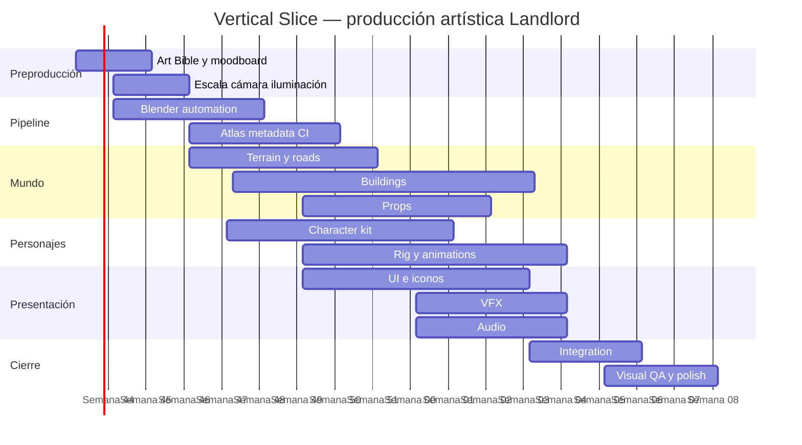

# Visual Direction Spike

> Estado: pendiente.
>
> Objetivo: reducir incertidumbre antes de producir arte masivamente y convertir propuestas de la Art Bible/Pipeline en decisiones medibles.

## Hipótesis a comparar

Preparar 2–3 direcciones originales que compartan el mismo contenido funcional pero varíen de forma controlada en:

- nivel de estilización;
- densidad de detalle;
- contraste/silueta;
- materialidad;
- paleta y grading;
- escala de personaje;
- complejidad de iluminación.

No usar assets ni trade dress de referencias históricas.

## Kit mínimo por dirección

- 1 carretera/acera/parcela;
- 1 set básico grass/dirt;
- 1 edificio residencial;
- 1 edificio industrial o comercial;
- 1 trabajador;
- 1 civil;
- 1 vehículo o prop móvil;
- vegetación/props;
- construcción y deterioro/daño;
- selección y ownership;
- 1 overlay económico;
- 1 panel HUD;
- 1 familia mínima de iconos;
- 1 VFX de humo/polvo.

Todo el kit debe atravesar la cadena de producción que se pretende usar en producción.

## Criterios de decisión

| Criterio | Peso |
|---|---:|
| Legibilidad a 50/75/100/150/200 % | 20 % |
| Identidad propia / distancia de IP ajenas | 15 % |
| Coste de producción repetible | 15 % |
| Rendimiento web y memoria | 15 % |
| Variación modular | 10 % |
| Calidad visual percibida | 10 % |
| Facilidad para colaboradores | 5 % |
| Automatización reproducible | 5 % |
| Accesibilidad / color blindness | 5 % |

Además debe superarse un smoke técnico de atlas, carga, anchor, depth sorting, selección y visual regression.

## Debe quedar congelado al cerrar el spike

- ortho camera rig y elevación exacta;
- relación del footprint isométrico;
- tile/grid de referencia;
- escala física de celda;
- escala relativa de personajes, vehículos y edificios;
- lighting rig;
- familia de paleta/materiales;
- estrategia de master resolution;
- baseline de direcciones/FPS de personajes;
- atlas strategy;
- naming y metadata v1;
- formato runtime baseline;
- budgets iniciales de textura/descarga;
- tooling mínimo obligatorio;
- reglas de Art Lab y golden scenes.

Cualquier elemento que no se haya medido debe permanecer explícitamente abierto.

## Referencia de producción posterior

## Plan de producción del Vertical Slice y checklist de entrega

El objetivo no debería ser “hacer gráficos”.

El objetivo del primer ciclo artístico debe ser demostrar que **podemos producir gráficamente todo el juego de forma repetible**.

Primero haría un **Visual Direction Spike** de aproximadamente dos semanas.

Debe incluir únicamente:

```text
1 road
1 grass/dirt set
1 residential building
1 industrial building
1 worker
1 civilian
1 construction animation/state
1 smoke effect
1 HUD panel
1 icon family
```

Pero todo debe atravesar el pipeline definitivo.

Después se expande al Vertical Slice.

**Inventario mínimo recomendado**

| Categoría | Cantidad orientativa | Complejidad |
|---|---:|---|
| terrain bases | 6–8 | baja |
| road/curb combinations | 16–24 | media |
| parcel/zoning overlays | 6–8 | baja |
| edificios residenciales | 3 | media |
| comerciales | 3 | media |
| industriales | 3 | alta |
| HQ/oficina | 1 | alta |
| policía/cívico | 1–2 | media |
| utility | 2 | media |
| estados construcción | por edificio | automatizado |
| damage variants | 5–8 relevantes | media |
| environment props | 25–40 | baja |
| árboles/vegetación | 8–12 | baja |
| vehículos | 3–5 | media |
| character archetypes | 5–6 | alta |
| animation sets | 4–5 base | alta |
| VFX | 8–12 | media |
| HUD icon set | 30–40 | media |
| panel families | 6–8 | alta |
| cursors/selection feedback | 8–12 | baja |
| SFX | 30–50 | media |
| ambient loops | 4–6 | media |
| musical tracks | 1–3 para slice | especializada |

Un asset como:

```text
bld_factory_brick_a
```

no cuenta como cinco assets porque tenga:

```text
foundation
construction
complete
damaged
abandoned
```

El pipeline debe abaratar la generación de esos estados.

**Estimación de producción**

| Trabajo | Jornadas-persona |
|---|---:|
| Art Bible + referencias | 10–15 |
| cámara/escala/light rig | 5–8 |
| pipeline Blender | 10–15 |
| atlas/manifest tooling | 8–12 |
| terrain/roads | 20–30 |
| environment buildings | 45–60 |
| props/vegetation | 15–20 |
| characters | 20–30 |
| rig/animation | 25–35 |
| VFX | 10–15 |
| UI/iconography | 25–35 |
| audio | 12–18 |
| integration/QA/polish | 20–30 |
| **Total** | **225–323 jornadas-persona** |

No significa 225–323 días calendario. Gran parte ocurre en paralelo.

Equipo artístico razonable para Vertical Slice:

| Perfil | FTE aproximado |
|---|---:|
| Art Director / Lead | 0,5 |
| Environment / 3D Generalist | 1 |
| Character Artist / Animator | 1 |
| Technical Artist | 0,5–1 |
| UI/2D Artist | 0,5–1 |
| Audio | 0,2–0,3 |
| Gameplay programmer para integración | 0,25–0,5 |

Con unas 4–5 FTE efectivas, el arte representativo de un Vertical Slice podría desarrollarse aproximadamente en **12–16 semanas**, suponiendo que el estilo y pipeline quedan resueltos pronto. Esta estimación excluye todavía una producción masiva tipo juego final.



Las fechas son ilustrativas; lo importante es la dependencia: **Art Bible → camera/light rig → pipeline → producción masiva**, no al revés.

**Flujo de madurez del asset**

```text
PLACEHOLDER
    ↓
BLOCKOUT
    ↓
STYLE CHECK
    ↓
GAMEPLAY APPROVED
    ↓
PRODUCTION MODEL
    ↓
MATERIAL
    ↓
RENDER
    ↓
ENGINE CHECK
    ↓
POLISH
    ↓
FINAL
```

Una regla especialmente importante:

> **No pulir un asset cuyo footprint o función de gameplay aún pueda cambiar.**

Así evitamos gastar tres días en ventanas y ladrillos de un edificio que Game Design eliminará mañana.

**Definition of Done para entregar un building**

```text
ART

[ ] respeta Art Bible
[ ] silueta legible
[ ] escala aprobada
[ ] materiales aprobados
[ ] lighting rig oficial
[ ] no contiene elementos IP ajenos

SOURCE

[ ] .blend limpio
[ ] nombres válidos
[ ] origin correcto
[ ] ANCHOR_ROOT presente
[ ] footprint definido
[ ] transforms saneados
[ ] materiales reutilizables donde corresponda

RENDER

[ ] cámara oficial
[ ] fondo transparente
[ ] master correcto
[ ] alpha limpio
[ ] estados obligatorios
[ ] orientaciones obligatorias

PIPELINE

[ ] metadata válida
[ ] provenance
[ ] author
[ ] license
[ ] atlasGroup
[ ] tags
[ ] render reproducible headless

ENGINE

[ ] carga en Phaser
[ ] pivot correcto
[ ] depth sorting correcto
[ ] selección correcta
[ ] placement correcto
[ ] save/load no depende del asset visual

PERFORMANCE

[ ] atlas dentro de budget
[ ] tamaño runtime correcto
[ ] sin texture switches innecesarios
[ ] probado en escena densa

QA

[ ] golden screenshot
[ ] visual diff aprobado
[ ] legible en zoom far
[ ] probado contra fondos distintos
```

**Herramientas recomendadas**

| Herramienta | Papel | Prioridad |
|---|---|---|
| Blender | modelado, rig, animación, render | obligatoria |
| Substance Painter | material/texturing avanzado | recomendada |
| Photoshop / Krita | concepts, paintover, UI source | opcional |
| Aseprite | VFX sprites, pequeños retoques, sheets | útil |
| TexturePacker | atlas automation | recomendada |
| Spine | animación 2D especializada/UI | futura |
| DragonBones/Loongbones | alternativa skeletal | no core |
| Tiled | terrain/map authoring | evaluar |
| Playwright | visual regression web | obligatoria |
| Pixelmatch | diff perceptual/pixel | recomendada |
| Git LFS | binarios fuente | obligatoria |

Aseprite puede generar sheets y JSON desde CLI, TexturePacker soporta packing reproducible y Blender permite render headless; eso significa que prácticamente toda la transformación desde fuente hasta runtime puede automatizarse.

**Ejemplos y documentación prioritaria**

Blender 4.5 LTS, CLI:

```text
https://docs.blender.org/manual/en/4.5/advanced/command_line/render.html
```

Blender glTF:

```text
https://docs.blender.org/manual/es/4.5/addons/import_export/scene_gltf2.html
```

Phaser textures:

```text
https://docs.phaser.io/phaser/concepts/textures
```

Phaser animations:

```text
https://docs.phaser.io/phaser/concepts/animations
```

TexturePacker CLI:

```text
https://www.codeandweb.com/texturepacker/documentation/commandline/parameters
```

Aseprite CLI:

```text
https://www.aseprite.org/docs/cli/
```

Aseprite pivots/slices:

```text
https://www.aseprite.org/docs/slices/
```

Substance Painter export:

```text
https://experienceleague.adobe.com/en/docs/substance-3d-painter/using/export/export
```

Spine + Phaser:

```text
https://en.esotericsoftware.com/spine-phaser
```

Tiled:

```text
https://doc.mapeditor.org/en/stable/
```

Git LFS:

```text
https://git-lfs.com/
```

GitHub y LFS:

```text
https://docs.github.com/en/repositories/working-with-files/managing-large-files/about-git-large-file-storage
```

Playwright visual regression:

```text
https://playwright.dev/docs/test-snapshots
```

Pixelmatch:

```text
https://github.com/mapbox/pixelmatch
```

WCAG 2.2:

```text
https://www.w3.org/TR/WCAG22/
```

Internacionalización W3C:

```text
https://www.w3.org/International/articles/article-text-size.en.html
```

Guía artística pública de Dota 2:

```text
https://www.dota2.com/workshop/build/references?l=spanish
```

Frostpunk 2 dispone incluso de una guía visual pública de vestuario que, aunque no sea una Art Bible del juego, constituye un buen ejemplo de cómo formalizar materiales, formas y detalles para que terceras personas puedan reproducir una identidad visual coherente.

```text
https://11bitstudios.com/docs/FP2_Cosplay_Guide_complete.pdf
```

Para Landlord, por tanto, **la creación de gráficos no es una tarea posterior a la programación**. Debe convertirse en una disciplina de ingeniería de contenido desde el próximo ciclo. La arquitectura actual ya señala correctamente `Blender → render/bake → atlas → Phaser`; lo que falta es convertir esa frase en una Art Bible versionada, un rig canónico de cámara/iluminación, schemas de metadata, un `art-lab`, scripts headless y un pipeline reproducible.

La decisión más importante que extraería de toda esta investigación es que **el primer gran entregable artístico de Landlord no debería ser un edificio precioso: debería ser un edificio que cualquier artista pueda modificar en Blender y que, con un solo comando, vuelva a aparecer correctamente iluminado, anclado, recortado, empaquetado, cargado en Phaser y validado visualmente**. Una vez existe esa cadena, producir una ciudad deja de ser un proceso artesanal y pasa a convertirse en una línea de producción escalable.
