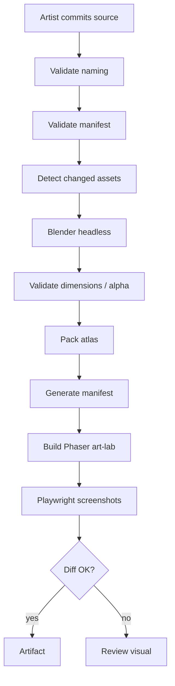
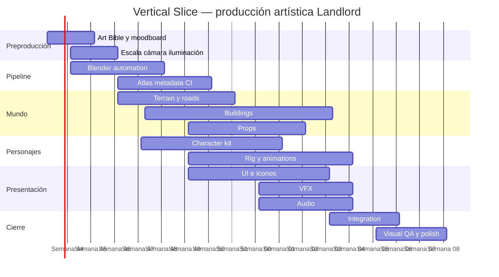

# Investigación avanzada — Art Bible y Art Pipeline de Landlord

> Estado: investigación de referencia, no ADR.
>
> Fecha de incorporación al repositorio: 2026-10-21.
>
> Este documento conserva el contenido completo de la investigación avanzada que originó la Art Bible y el Art Pipeline v0.1. Los marcadores internos de citas de la sesión se han eliminado porque no son referencias portables fuera de ChatGPT. Los enlaces públicos incluidos explícitamente en la investigación se conservan. Las decisiones propuestas sólo pasan a ser vinculantes cuando se ratifican mediante el proceso de decisión del repositorio.

## Resumen ejecutivo

La conclusión de la investigación es que **Landlord debería adoptar formalmente un pipeline 3D → prerender 2D/2.5D**, con Blender como fuente tridimensional y Phaser como consumidor de sprites/atlases. No sería una desviación respecto al proyecto: el repositorio ya establece TypeScript, Phaser y React, y contempla explícitamente `Blender -> render/bake -> atlas de sprites -> Phaser`; además, el toolchain actual fija Phaser 4.2.1.

La decisión también tiene un precedente histórico especialmente pertinente: el dossier de Constructor/Street Wars documenta que Studio 3 estudió pasar a 3D, pero terminó manteniendo gráficos isométricos basados en bitmaps para preservar la nitidez visual y ampliar la compatibilidad. Landlord puede conservar esa ventaja estética, pero utilizar herramientas 3D modernas para producir automáticamente esos bitmaps en vez de dibujarlos manualmente.

La captura oficial de *Constructor Plus* anterior ilustra una de las fortalezas que Landlord debería conservar: una ciudad que, incluso con mucha actividad, presenta edificios de silueta muy diferenciada, personajes visibles y una jerarquía inmediata entre terreno, construcción y elementos interactivos. System 3 anuncia más de 140 edificios en *Constructor Plus*, lo que también demuestra por qué necesitamos un pipeline industrializable en lugar de producir sprites artesanalmente uno por uno.

Mi recomendación arquitectónica y artística es la siguiente:

| Decisión | Propuesta Landlord |
|---|---|
| Representación del mundo | 2.5D isométrico/dimétrico prerenderizado |
| Fuente artística principal | Blender 4.5 LTS o versión LTS fijada por proyecto |
| Render de producción | EEVEE |
| Render de referencia | Cycles sólo cuando aporte valor |
| Cámara | ortográfica, azimut 45°, elevación calibrada a footprint 2:1 |
| Grid base recomendado | 128×64 px |
| Master de render | equivalente 2×: 256×128 px por celda |
| Estética | realismo estilizado, caricatura moderada |
| Época visual inicial | ciudad ficticia inspirada en 1925–1940 |
| Paleta | industrial cálida, ladrillo, carbón, crema, latón, petróleo |
| Iluminación | fija y canónica; luz principal desde noroeste visual |
| Assets estáticos | sprites prerenderizados |
| Personajes | rigs 3D → sprites de 8 direcciones |
| UI | React/CSS/SVG, no prerenderizada |
| VFX | mezcla de sprites pequeños + partículas/procedural |
| Atlas | 2048² como baseline, multipack |
| Formato runtime inicial | PNG RGBA + JSON/PCT según integración |
| Optimización posterior | texturas GPU comprimidas + variantes de resolución |
| Fuentes artísticas | `.blend`, `.spp`, `.psd/.kra`, `.aseprite`, WAV |
| Gestión binaria | Git LFS |
| QA | Playwright + pixel/perceptual diff + escenas patrón |
| Producción | placeholder → approved blockout → production → polish |

La Art Bible y el Art Pipeline deben ser **dos documentos distintos aunque relacionados**:

**Art Bible** responde a:

> ¿Cómo debe verse Landlord?

**Art Pipeline Specification** responde a:

> ¿Cómo conseguimos que cien personas o agentes diferentes produzcan assets que siempre acaben viéndose como Landlord?

Esa distinción es importante. Valve, por ejemplo, publica para el Workshop de Dota 2 guías separadas sobre arte de personajes, modelado, UV, baking de iluminación, máscaras, VFX y animación; es un buen precedente público de convertir una dirección visual en restricciones técnicas reproducibles.

La Art Bible de Landlord debería contener, al menos:

```text
ART BIBLE
│
├── Visual Pillars
├── Era & World
├── Architecture
├── Shape Language
├── Character Language
├── Palette
├── Materials
├── Lighting
├── Scale
├── Camera
├── Environment
├── UI
├── Iconography
├── VFX
├── Animation
├── Accessibility
├── Do / Don't examples
└── Golden Screenshots
```

Y la especificación técnica:

```text
ART PIPELINE
│
├── Source formats
├── Scene templates
├── Units / grid
├── Camera rig
├── Lighting rig
├── Blender naming
├── Rigging conventions
├── Rendering
├── Post-processing
├── Sprite generation
├── Atlas packing
├── Metadata
├── Validation
├── Phaser ingestion
├── LFS
├── CI
├── Visual regression
└── Performance budgets
```

El punto crítico es no producir todavía cien edificios. Hay que construir **la fábrica de edificios**.

## Referencias visuales y dirección artística

La comparación de referencias conduce a una dirección bastante concreta. Landlord no debería intentar superar a *Anno* o *Cities: Skylines* en realismo geométrico; perdería la principal ventaja de su arquitectura web 2.5D. Tampoco recomiendo convertirlo en pixel art puro. Su espacio más interesante está entre el carácter legible de *Constructor*, la sofisticación histórica de *Anno*, la fuerte identidad atmosférica de *Frostpunk* y la claridad sistémica de *RimWorld/Prison Architect*.

| Referencia | Qué funciona visualmente | Qué tomar para Landlord | Qué no copiar |
|---|---|---|---|
| **Constructor / Mob Rule** | isométrico bitmap, edificios inmediatamente identificables, humor, exageración | siluetas, lectura instantánea, personalidad | assets, personajes, iconografía y diseño concreto |
| **Constructor Plus** | misma legibilidad llevada a más variedad y resolución | diferenciación extrema de negocios y utilities | exceso de color/ruido en algunas escenas |
| **Anno 1800** | materiales ricos, arquitectura históricamente evocadora, densidad urbana creíble | materialidad, kit arquitectónico, evolución socioeconómica visible | presupuesto de detalle 3D completo |
| **Cities: Skylines** | ecosistema de assets y modularidad | disciplina de metadata/importación y kits urbanos | perseguir fotorrealismo 3D |
| **Frostpunk** | atmósfera como parte de la identidad del juego | VFX, clima, color grading, lectura emocional | oscuridad que perjudique información económica |
| **Tropico 4/5** | entorno cálido, colorido, edificios distinguibles y política visible | mezcla entre ciudad, personajes y humor | estética tropical concreta |
| **Prison Architect** | forma antes que detalle | lectura sistémica, iconografía | simplicidad extrema para edificios premium |
| **RimWorld** | estilo icónico de bajo coste | claridad de agentes a distancia | representación abstracta completa |
| **Banished** | ciudad orgánica, materiales naturales y coherencia de escala | cohesión arquitectónica y ambiental | coste de producción 3D completo |
| **SimCity 2000** | lectura por tiles, silueta urbana y densidad comprensible | ortogonalidad del sistema bajo la imagen | resolución/pixelización histórica |
| **Two Point Hospital** | volúmenes exagerados y personajes legibles | exaggeration controlada y siluetas | tono completamente cartoon |
| **Stardew Valley** | extraordinaria coherencia entre sprites, paleta y entorno | disciplina de paleta y repetición modular | pixel art como dirección principal |

La base histórica de *Street Wars/Mob Rule* es especialmente valiosa porque el juego final mantuvo bitmaps isométricos pese a haberse considerado 3D. *Constructor Plus*, por su parte, muestra cómo esa gramática puede sostener más de 140 edificios y múltiples mundos.

*Anno 1800* es probablemente la referencia más útil para **materiales y arquitectura**. Ubisoft explicó que su departamento artístico creó y texturizó cientos de assets para producir una industrialización urbana creíble, y que el número de materiales por asset fue ya un problema de producción significativo. Esto confirma que Landlord necesita reutilización material y kits modulares, aunque el resultado se bakee a sprites.

*Cities: Skylines II* es menos relevante como estética 2.5D, pero muy relevante como ingeniería de contenido: su sistema de custom assets separa importación, workspace, subobjetos, metadata y publicación; Colossal Order llegó a identificar serialización y virtual texturing como problemas técnicos específicos del soporte de assets. Es una buena lección para no confundir “un PNG bonito” con “un asset de juego correctamente definido”.

*Frostpunk* aporta otra lección: 11 bit Studios describió la eliminación de la nieve como un cambio tan grande que se preguntaron si el resultado seguiría sintiéndose como *Frostpunk*. Es decir, ciertos elementos visuales dejan de ser decoración y pasan a formar parte de la identidad del producto. Para Landlord deberían cumplir ese papel el humo industrial, la suciedad acumulada, la lluvia, la luz de escaparates, los carteles, las calles y la progresión visual del capital.

*Prison Architect* demuestra el valor de preservar un lenguaje de formas: al trabajar en su transición de 2D a 3D, el equipo explicó explícitamente que quería conservar el aspecto reconocible del original. Ludeon explica, además, que durante el desarrollo temprano de *RimWorld* la dirección utilizaba deliberadamente un estilo sencillo e icónico antes de incorporar a un artista dedicado.

*Banished* ofrece una advertencia productiva extremadamente útil. Su desarrollador recuerda que inicialmente quería prácticamente “cero animación” porque modelado, rigging, keyframes y animación eran demasiado trabajo para un desarrollador solitario; posteriormente construyó esa capacidad gradualmente. Para Landlord esto justifica automatizar direcciones y frames desde un rig 3D común en lugar de animar sprites independientemente.

*SimCity 2000* sigue siendo relevante por la legibilidad de sistemas superpuestos: la propia ficha actual de EA recuerda carreteras, ferrocarril, servicios, capa subterránea y conjuntos gráficos personalizables.

*Stardew Valley* merece una precisión: no lo usaría como referencia de prerender isométrico, porque su lenguaje visual es pixel-art 2D. Sí es excelente referencia de **consistencia absoluta de escala, paleta y sprites**; su sitio oficial conserva una galería amplia de capturas para construir moodboards comparativos.

**Dirección artística propuesta para Landlord**

La frase que debería encabezar la Art Bible sería:

> **Una ciudad industrial viva, atractiva pero moralmente ambigua, representada como una maqueta cinematográfica isométrica en la que riqueza, deterioro, poder y crimen pueden leerse sin abrir un panel.**

Cinco pilares:

**Legibilidad antes que detalle.** Un edificio debe poder identificarse por silueta antes de leer su cartel.

**Historia sin documentalismo.** Inspiración 1925–1940 para el primer escenario, pero ciudad ficticia. No necesitamos reproducir literalmente Chicago, Londres o Nueva York.

**Caricatura material.** Proporciones ligeramente exageradas, pero ladrillos, metal, piedra, vidrio, hollín y madera deben resultar materiales convincentes.

**La economía se ve.** Un barrio que prospera cambia visualmente; uno empobrecido también.

**Oscuridad con humor.** El mundo puede contener corrupción y crimen sin ser permanentemente gris ni deprimente.

La época propuesta para el primer vertical slice sería **finales de los años veinte / principios de los treinta en una ciudad ficticia transatlántica**. Permite conectar art déco, ladrillo industrial, tranvías, automóviles tempranos, sindicatos, especulación inmobiliaria, política urbana y crimen organizado sin quedar encadenados a una geografía real.

No convertiría esto en una restricción del motor. Las futuras épocas serían *theme packs*:

```text
era_1920
era_1950
era_1970
era_modern
```

La composición cromática propuesta:

| Token artístico | Hex orientativo | Uso |
|---|---:|---|
| `coal` | `#25282A` | acero, tejados, sombra |
| `warm_plaster` | `#D6C4A1` | fachadas y piedra clara |
| `brick` | `#8C503D` | industria y vivienda |
| `brass` | `#B08A50` | riqueza, señalética |
| `petrol` | `#315A5E` | industrial, transporte |
| `olive` | `#696C52` | servicios/utilidades |
| `paper` | `#E8DFC8` | UI y documentación |
| `danger` | `#A74339` | alerta, policía, pérdida |

Estos valores son **tokens iniciales, no una paleta cerrada**. El arte del mundo puede disponer de centenares de colores; lo que se limita es la distribución de familias cromáticas para mantener identidad.

La riqueza debería modificar el lenguaje material:

```text
POBRE
yeso
madera
ladrillo expuesto
carteles baratos
desgaste
humo

CLASE MEDIA
ladrillo limpio
piedra
toldos
vegetación
mejor iluminación

ALTA
piedra labrada
latón
cristal
mármol
fachadas simétricas
ornamento
```

Así el jugador podría identificar la estratificación económica directamente desde la ciudad.

La identidad visual también debería propagarse por **deterioro**:

```text
state_pristine
state_used
state_neglected
state_damaged
state_abandoned
```

No hace falta modelar cinco edificios distintos. Una parte puede obtenerse mediante decals, materiales y overlays antes del prerender.

**Escala y cámara**

Para el juego recomiendo establecer como unidad lógica:

```text
1 CELL
=
1 square in world space
=
128 × 64 px projected footprint at 100 % reference zoom
```

El render master se generaría al doble:

```text
256 × 128 px
```

y de él se derivaría la variante estándar. La resolución master no determina necesariamente el tamaño del sprite completo: un edificio de cuatro plantas podría ocupar cientos de píxeles verticales.

Opciones consideradas:

| Grid proyectado | Ventajas | Inconvenientes | Recomendación |
|---|---|---|---|
| 64×32 | ligero, retro, muchos objetos | personajes/props pierden detalle | no como baseline |
| **128×64** | buen equilibrio para 1080p/1440p | coste moderado | **elegido** |
| 256×128 | excelente detalle | atlases y memoria crecen rápido | master/HiDPI |
| 1:1 diamond | más vertical, aspecto distinto | menos conectado al legado | descartar inicialmente |

Tiled permite configurar explícitamente orientación isométrica, `tilewidth` y `tileheight`, mantiene grid lógico separado de la imagen y ofrece alineación específica para objetos isométricos. Por tanto, el editor de mapas puede seguir trabajando con coordenadas lógicas aunque los sprites superen ampliamente el tamaño de una celda.

Para generar un rombo 2:1 de una cuadrícula cuadrada, propondría una cámara ortográfica orientada aproximadamente con **45° de azimut y 30° de elevación sobre el horizonte**. En lugar de almacenar rotaciones Euler “mágicas” manualmente, el pipeline debe tener un `camera_rig.py` que oriente la cámara hacia el origen y compruebe automáticamente que un cuadrado de prueba genera el footprint esperado. Blender dispone de cámara ortográfica y de un `Orthographic Scale` explícito, lo que hace este rig perfectamente reproducible.

**Referencias visuales prioritarias**

Captura oficial de Constructor Plus:

```text
https://image.api.playstation.com/cdn/UP4037/CUSA14667_00/FREE_CONTENT2EABdQIjWVT0HRW3Zr7T/ikgpWkEl_PREVIEW_SCREENSHOT3_175726.jpg
```

System 3:

```text
https://shop.system3.com/products/constructor-plus-pc
```

Anno 1800, análisis técnico de arte:

```text
https://news.ubisoft.com/en-us/article/69SwK8nqv5rDUdEzqbNt6h/create-the-unknown-how-anno-1800-put-a-creative-spin-on-the-industrial-revolution
```

Frostpunk, identidad visual:

```text
https://11bitstudios.com/pl/frostpunk_rizomuv/
```

Prison Architect, preservación de identidad 2D al migrar dimensionalmente:

```text
https://www.paradoxinteractive.com/games/prison-architect-2/news/dev-highlight-a-whole-new-dimension
```

Dota 2, ejemplo público de guía artística profesional:

```text
https://www.dota2.com/workshop/build/references?l=spanish
```

Como ejemplo comunitario de la **estructura documental** de una Art Bible, no como estándar industrial, también es útil revisar repositorios educativos públicos como KiwiTrek/ArtBible. La guía oficial de Dota 2 debe tener mucha más autoridad para criterios de producción.

## Pipeline técnico de Blender a sprites

El pipeline propuesto no consiste simplemente en pulsar “Render” en Blender. Debe ser una transformación reproducible desde fuente artística hasta recurso del navegador.


Blender está especialmente bien adaptado a esto porque soporta render sin interfaz gráfica y ejecución por línea de comandos; su documentación oficial contempla expresamente la automatización y renderizado remoto/headless. `blender -b file.blend -f 10` procesa un frame sin interfaz y `-a` puede procesar una animación completa.

**Versionado**

No utilizaría “Blender latest” en producción.

Usaría:

```text
tools/versions.json

{
  "blender": "4.5.x-LTS",
  "texturePacker": "...",
  "aseprite": "...",
  "assetSchema": 1
}
```

La versión exacta debe quedar fijada una vez validado el primer vertical slice.

**Plantilla de escena Blender**

Todos los assets se basarán en:

```text
templates/
    building.blend
    character.blend
    prop.blend
    vehicle.blend
```

Cada plantilla incluye:

```text
COL_CAMERA
COL_LIGHTING
COL_REFERENCE
COL_RENDER
COL_COLLISION_HELPERS
COL_ANCHORS
```

Y objetos reservados:

```text
CAM_GAME
LIGHT_KEY
LIGHT_FILL
ANCHOR_ROOT
FOOTPRINT
HEIGHT_GUIDE
```

**Sistema de unidades**

Propuesta:

```text
1 Blender unit = 1 metro
1 Landlord cell = 4 × 4 metros
```

El tamaño concreto de una celda física puede ajustarse durante el Visual Direction Spike, pero una vez aprobado debe convertirse en constante del proyecto. Lo importante es que **ningún artista escale a ojo para que “quede bien en pantalla”**.

**Cámara**

```text
projection      ORTHOGRAPHIC
azimuth         45°
elevation       ~30°
roll            0°
camera shift    0
```

El `orthographic_scale` se calcula a partir de footprint y output resolution.

No se permitirá perspectiva en assets del mundo.

**Iluminación canónica**

La iluminación queda fijada en la Art Bible:

```text
             KEY/SUN
                ↘
              CITY

camera → ◇
```

Propuesta:

- key solar desde el cuadrante noroeste de pantalla;
- sombras hacia sureste;
- fill ambiental suave;
- temperatura ligeramente cálida;
- ambient occlusion discreto;
- ningún punto completamente negro;
- highlights controlados;
- fondo transparente.

La razón es estructural: una vez horneada la iluminación dentro del sprite no podemos mover el sol dinámicamente sin revelar que los edificios no están iluminados igual.

Por ello **Landlord v1 no debería tener ciclo completo de día/noche con luz físicamente móvil**.

Puede tener:

```text
día
lluvia
niebla
noche estilizada
```

mediante variantes, lightmaps/overlays, ventanas iluminadas, partículas y grading.

Un verdadero ciclo solar requeriría renders por dirección/estado o migrar parte de la iluminación al runtime, y debe considerarse una feature independiente.

**Motor de render**

Mi baseline sería **EEVEE**. Blender lo define como su motor de render en tiempo real centrado en velocidad e interactividad y compatible con materiales PBR, lo que encaja mejor con cientos o miles de renders automatizados que Cycles.

Cycles se reserva para:

- renders de referencia;
- comprobar materiales;
- hero images;
- marketing;
- detectar desviaciones de EEVEE.

**Texturizado**

El pipeline PBR interno puede trabajar con:

```text
BaseColor
Roughness
Metallic
Normal
AO
Emission
```

aunque al final se convierta en un único sprite RGBA.

Esto es muy útil: permite crear materiales reutilizables como:

```text
mat_brick_red_01
mat_brick_dirty_01
mat_plaster_warm_01
mat_steel_painted_01
mat_brass_01
mat_asphalt_01
mat_wood_dark_01
```

Substance 3D Painter permite definir Output Templates que controlan nomenclatura, channel packing, formato y profundidad de salida, y soporta, entre otros, PNG y WebP. Adobe también incluye un preset orientado a Blender/Principled BSDF.

No obstante, **Substance no debe ser obligatorio para contribuir al proyecto**. Un colaborador debería poder crear un asset completamente válido con Blender.

**Formato fuente**

Jerarquía recomendada:

```text
authoritative:
    .blend

optional texturing source:
    .spp
    .psd
    .kra

interchange:
    .glb

render master:
    .png / .exr

runtime:
    .png
    atlas metadata
```

No utilizaría glTF como formato artístico canónico. Blender puede exportar escenas, materiales, animación y propiedades personalizadas a glTF/GLB, pero determinadas características propias de Blender necesitan extensiones y no todo el grafo de trabajo constituye una representación perfecta del `.blend`. GLB debe ser **intercambio**, no “master source”.

**Salida de render**

Para vertical slice:

```text
Master:
PNG RGBA 16-bit
transparent background

Runtime:
PNG RGBA 8-bit
```

PNG soporta alfa y Blender puede trabajar con PNG de 8/16 bits; utilizar 16 bit en el master deja margen de grading antes de reducir a 8 bits.

OpenEXR tiene sentido si el proyecto necesita pases o composición HDR compleja, pero introducirlo obligatoriamente desde el principio añade fricción innecesaria.

**PNG, WebP y AVIF**

La política recomendada es:

| Uso | Formato |
|---|---|
| master sprite | PNG 16 bit |
| atlas baseline | PNG 8 bit |
| fondos grandes UI | WebP |
| splash/marketing | AVIF + WebP fallback |
| iconografía | SVG cuando sea DOM |
| texturas GPU futura | KTX/PVR según soporte |

Phaser acepta imágenes que pueda presentar el navegador y soporta spritesheets, atlas y multiatlas; también dispone de carga de texturas GPU comprimidas con fallback a imágenes convencionales.

WebP y AVIF aportan opciones modernas de compresión web, mientras PNG sigue proporcionando compresión lossless y alfa completo. Para Landlord empezaría con PNG en atlases y cambiaría únicamente después de benchmark, no por anticipación.

**Naming convention**

Todo en ASCII, `lower_snake_case`, sin espacios.

Tipos:

```text
bld_  building
chr_  character
veh_  vehicle
prp_  prop
ter_  terrain
vfx_  effect
ui_   interface
ico_  icon
snd_  sound
mus_  music
```

Edificio:

```text
bld_res_rowhouse_a_r0_complete
bld_res_rowhouse_a_r0_build_25
bld_res_rowhouse_a_r0_build_50
bld_res_rowhouse_a_r0_damaged
```

Personaje:

```text
chr_worker_m01_idle_ne_f000
chr_worker_m01_walk_ne_f000
chr_worker_m01_walk_ne_f001
```

Terreno:

```text
ter_asphalt_clean_a
ter_grass_dry_a
ter_road_straight_ne_sw
```

No colocaría `v001`, `final`, `final2`, etc. en IDs runtime.

La versión pertenece a Git y al manifest.

**Anchor**

Esta es una de las especificaciones más importantes.

No se debe fijar manualmente un pivot “aproximadamente en los pies”.

El `.blend` contiene:

```text
ANCHOR_ROOT
```

El script proyecta ese punto con la cámara oficial y escribe el resultado en metadata.

En personajes:

```text
ANCHOR_ROOT = midpoint between feet on ground
```

En edificios:

```text
ANCHOR_ROOT = footprint origin / ground plane
```

De esta manera, trim y atlas packing no rompen posicionamiento.

**Trim**

TexturePacker puede eliminar transparencias manteniendo información de tamaño original, aplicar márgenes y extruir píxeles de borde para evitar seams al escalar o muestrear entre texels. También soporta multipack y pivots.

Configuración inicial:

```text
trim                 on
trim threshold       1
trim margin          2 px
extrude              2 px
shape padding        4 px
border padding       4 px
rotation in atlas    off
algorithm            MaxRects
max atlas            2048×2048
multipack            on
```

Desactivaría inicialmente la rotación del sprite dentro del atlas para simplificar tooling, inspección y debugging.

**Atlases**

No utilizaría un gigantesco `game.png`.

Separaría por afinidad:

```text
atlas_terrain
atlas_buildings_residential
atlas_buildings_commercial
atlas_buildings_industrial
atlas_characters_workers
atlas_characters_civilians
atlas_vfx
```

TexturePacker permite limitar dimensiones y producir múltiples hojas automáticamente; su valor predeterminado actual para `--max-size` es 2048 y soporta salida Phaser con multipack.

Phaser diferencia entre spritesheet —celdas uniformes— y atlas —frames de tamaños y posiciones arbitrarias— y soporta `multiatlas` para contenidos que no caben en una sola textura.

## Sprites, animaciones, terreno, UI, VFX y audio

**Personajes**

La automatización del prerender hace económicamente viable usar más direcciones que en un pipeline dibujado a mano.

Baseline:

```text
N   NE   E   SE   S   SW   W   NW
```

Es decir, **8 direcciones**.

No usaría mirroring automático como política principal, porque:

- ropa asimétrica;
- objetos en manos;
- uniformes;
- armas;
- texto o insignias

pueden quedar incorrectos.

El pipeline puede ofrecer mirroring únicamente para un asset que declare:

```json
{
  "mirrorSafe": true
}
```

Animaciones iniciales:

| Animación | Frames orientativos | FPS | Loop |
|---|---:|---:|---|
| idle | 6–8 | 6 | sí |
| walk | 8 | 10–12 | sí |
| carry | 8 | 10–12 | sí |
| work | 10–16 | 10–12 | sí |
| talk | 6–10 | 8 | sí |
| interact | 8–12 | 10 | no |
| injured | 4–8 | 6 | depende |

Son presupuestos de Landlord, no restricciones del motor. Phaser utiliza precisamente secuencias de frames almacenadas en spritesheets o atlas como mecanismo principal de animación.

Una animación de:

```text
8 directions
×
8 frames
=
64 renders
```

parece enorme manualmente.

Pero con un rig:

```text
Blender
→ animation
→ rotate rig/camera eight times
→ batch render
```

son 64 outputs de una única animación.

Ahí está una de las principales ventajas de este pipeline.

**Modularidad**

No recomiendo construir cada ciudadano a runtime con:

```text
body
+ trousers
+ shirt
+ jacket
+ hair
+ hat
+ item
```

porque multiplicaría sprites/draws y complicaría depth ordering.

La modularidad principal ocurrirá **offline**:

```text
BASE RIG
   ↓
body preset
clothes preset
hair preset
palette preset
   ↓
automated render
   ↓
finished character sprite
```

Con veinte prendas podríamos producir cientos de personas con scripts sin aumentar la complejidad del renderer.

Runtime layering queda reservado para cosas muy específicas:

- objeto que lleva en la mano;
- indicador de selección;
- ciertos sombreros/accesorios;
- highlight;
- faction marker.

Si en el futuro se quieren personajes 2D esqueléticos, Spine tiene runtime oficial para Phaser y consume skeleton data junto a texture atlases. Es una opción técnicamente válida, pero **no lo elegiría para los ciudadanos principales mientras Landlord siga el pipeline 3D→prerender**.

DragonBones conserva un modelo de atlas + datos de animación JSON, pero su ecosistema oficial ha ido evolucionando hacia Loongbones; por estabilidad del proyecto no lo pondría en el camino crítico.

Aseprite sí puede tener un papel útil como herramienta auxiliar. Su CLI exporta spritesheets y JSON y sus `Slices` pueden contener pivots; sirve muy bien para VFX 2D, retoques frame a frame, iconos o animaciones deliberadamente dibujadas.

**Edificios**

Los edificios no requieren ocho vistas si la cámara nunca gira.

Vertical Slice:

```text
orientation = 1
```

Si posteriormente permitimos rotación en pasos de 90°:

```text
R0
R90
R180
R270
```

se generan cuatro renders automáticamente.

Estados mínimos:

```text
planned
foundation
construction_50
complete
damaged
```

Para determinados edificios:

```text
abandoned
upgraded_1
upgraded_2
```

La variación debe producirse primero con materiales/props y sólo después mediante modelos completamente distintos.

**LOD artístico**

En un juego prerender no haría LOD como en un motor 3D tradicional.

Tres capas:

```text
NEAR
high-resolution sprite
props visible
characters animated

MID
same asset / mip chain
reduced minor VFX

FAR
half-resolution asset family
fewer characters
signage/props hidden

MAP
district abstraction
icons / blocks / heatmap
```

Esto permite que el alejamiento de cámara reduzca no sólo detalle visual sino también coste de simulación, conectando bien con el Simulation LOD que ya estamos diseñando.

**Tiles y terreno**

No derive nunca colisiones de transparencia.

La imagen y la lógica son independientes:

```text
Visual tile
    │
    └── tile id

Logical cell
    ├── walkable
    ├── buildable
    ├── road
    ├── terrain
    ├── district
    └── occupancy
```

Tiled soporta mapas isométricos, layers, terrain tools, objetos y propiedades personalizadas; estas últimas pueden heredarse desde tiles a sus instancias.

Tiles mínimos:

```text
grass
dirt
mud
asphalt
pavement
industrial_ground
water
```

No crearía cada carretera como un bitmap monolítico.

Separaría:

```text
base
road surface
curb
markings
decals
props
```

y usaría variantes compatibles con grid.

Los collision/footprint masks deben almacenarse como data:

```json
{
  "assetId": "bld_res_rowhouse_a",
  "footprint": {
    "width": 2,
    "height": 3,
    "mask": [
      [1, 1],
      [1, 1],
      [1, 1]
    ]
  }
}
```

Un edificio irregular:

```json
[
  [1, 1, 0],
  [1, 1, 1],
  [0, 1, 1]
]
```

El snapping opera en coordenadas mundo, jamás en píxeles de sprite.

**UI**

Aquí no debemos imitar la tecnología de 1999.

El repositorio ya define React/DOM para HUD, economía, política, estadísticas y pantallas de empresa, y prohíbe utilizarlo como renderer de entidades.

La UI visual debería mezclar:

```text
papel / documentos
+
metal / latón
+
periodismo / prensa
+
tipografía moderna y muy legible
```

No haría todo con una fuente art déco.

Sistema:

```text
Display font
    sólo títulos / branding

UI sans
    todo dato operativo

Mono/tabular
    cifras financieras cuando sea útil
```

Un candidato razonable sería:

```text
display: una familia de inspiración Art Deco
body: IBM Plex Sans / Source Sans 3 o equivalente abierto
numeric: tabular numerals
```

La Art Bible debe fijar tipografías y licencias antes de producir screenshots públicos.

Tokens UI:

```text
--surface-0
--surface-1
--surface-raised

--text-primary
--text-secondary
--text-muted

--positive
--negative
--warning
--information

--ownership-player
--ownership-neutral
--ownership-rival

--politics-support
--politics-opposition
```

Rojo y verde **no pueden ser la única codificación**.

Ejemplo:

```text
↑ +12.5 %        beneficio
↓ -12.5 %        pérdida
```

con icono, signo y color.

Para WCAG 2.2, el texto normal debe alcanzar al menos 4,5:1 de contraste y el texto grande 3:1; además, el texto web debe poder ampliarse al 200 % sin perder contenido ni funcionalidad.

Los targets de interacción deben diseñarse con un mínimo práctico superior al estrictamente necesario. WCAG 2.2 establece 24×24 CSS px como criterio mínimo con ciertas excepciones; para Landlord recomiendo **36–44 px en controles primarios**.

**Localización**

Nunca:

```text
[ bitmap que contiene "BUY PROPERTY" ]
```

Siempre:

```text
icon
+
DOM text
```

W3C advierte que strings muy cortos pueden expandirse en traducción un 200–300 %, y las de 11–20 caracteres aproximadamente un 180–200 % como referencia de planificación.

Por ello:

- botones flexibles;
- min-width, no width rígido;
- wrapping controlado;
- pseudo-localización;
- test con alemán/español;
- arquitectura RTL desde componentes base;
- ningún texto importante bakeado.

**VFX**

Los VFX tienen dos funciones: espectáculo y feedback.

Prioridad:

```text
1. información
2. feedback
3. atmósfera
4. espectáculo
```

VFX sprite atlas:

- polvo de obra;
- humo;
- pequeñas chispas;
- vapor;
- fuego;
- hojas/papel;
- salpicaduras;
- pequeñas explosiones.

Procedural/runtime:

- selection ring;
- footprint;
- zoning overlay;
- influence overlay;
- rutas;
- arrows;
- highlights;
- area masks.

Evitaría sprites enormes de humo semitransparente apilados sobre media pantalla porque aumentan overdraw.

Los VFX atmosféricos constituyen una oportunidad importante para darle a Landlord su propia identidad, siguiendo la lección de Frostpunk de que los elementos ambientales pueden acabar formando parte del reconocimiento visual del juego.

**Audio**

La Art Bible debería tener un pequeño Audio Bible asociado.

Masters:

```text
48 kHz
24 bit
WAV
```

Categorías:

```text
UI
construction
industry
traffic
citizens
crime
police
weather
ambience
music
```

Para runtime web se generan formatos comprimidos desde los masters. Phaser puede recibir una lista de URLs alternativas para un mismo asset de audio.

Regla sonora:

> El jugador debe poder escuchar el estado económico de la ciudad sin que el sonido se convierta en ruido constante.

Por ejemplo:

```text
barrio pobre
→ perros, reparaciones, tráfico viejo

distrito industrial
→ martillos, vapor, maquinaria

centro rico
→ automóviles, música interior, actividad comercial

alta criminalidad
→ sirenas distantes, discusiones, cristales
```

El audio ambiental deberá usar concurrencia y prioridades para evitar reproducir cientos de emisores simultáneamente.

## Repositorio de assets, automatización e integración con Phaser

Dado que Landlord pretende admitir colaboración abierta, la estructura de assets debe ser comprensible sin hablar con el artista que los creó.

Durante Vertical Slice mantendría **un repositorio único**, antes que crear prematuramente infraestructura adicional.

```text
landlord/
│
├── art/
│   ├── README.md
│   ├── bible/
│   ├── concepts/
│   ├── blender/
│   │   ├── buildings/
│   │   ├── characters/
│   │   ├── vehicles/
│   │   ├── props/
│   │   └── templates/
│   ├── textures/
│   ├── substance/
│   ├── aseprite/
│   ├── ui-source/
│   ├── audio-source/
│   └── manifests/
│
├── assets-generated/
│   ├── frames/
│   ├── atlases/
│   ├── audio/
│   └── manifests/
│
├── apps/web/public/assets/
│   └── ...
│
├── tools/
│   └── art-pipeline/
│       ├── blender/
│       ├── pack/
│       ├── validate/
│       └── manifests/
│
└── docs/
    └── art/
        ├── ART-BIBLE.md
        ├── ART-PIPELINE.md
        ├── ASSET-NAMING.md
        ├── PERFORMANCE-BUDGET.md
        └── ASSET-CHECKLIST.md
```

Cuando la fuente artística alcance varios gigabytes o la gestión de permisos/licencias lo justifique, entonces sí evaluaría:

```text
landlord
landlord-art-source
```

pero no lo haría todavía.

**Git LFS**

Git LFS sustituye archivos grandes dentro del historial por pequeños pointers y almacena el contenido binario separado; GitHub recomienda LFS para binarios grandes.

`.gitattributes` inicial:

```gitattributes
*.blend filter=lfs diff=lfs merge=lfs -text
*.spp filter=lfs diff=lfs merge=lfs -text
*.psd filter=lfs diff=lfs merge=lfs -text
*.kra filter=lfs diff=lfs merge=lfs -text
*.aseprite filter=lfs diff=lfs merge=lfs -text
*.exr filter=lfs diff=lfs merge=lfs -text
*.wav filter=lfs diff=lfs merge=lfs -text
```

No metería automáticamente **todo PNG** en LFS. Iconos y pequeños runtime assets pueden ser perfectamente normales; los renders master muy grandes sí podrían entrar en LFS.

Hay un coste que debe vigilarse en un repositorio abierto: al modificar un archivo LFS, se almacena una nueva versión completa y ésta contabiliza nuevamente para almacenamiento; además, colaboradores sin Git LFS no reciben el binario original. GitHub recomienda documentar explícitamente este requisito para colaboradores.

**Provenance**

Cada asset entregable debe tener metadata.

Por ejemplo:

```json
{
  "schemaVersion": 1,
  "assetId": "bld_res_rowhouse_a",
  "type": "building",
  "category": "residential",
  "author": "github:luissereno",
  "origin": "original",
  "license": "PROJECT-ASSET-LICENSE",
  "source": "art/blender/buildings/res/rowhouse_a.blend",
  "artBibleVersion": "0.1",
  "toolchain": {
    "blender": "4.5.x"
  },
  "footprint": [2, 3],
  "anchor": "ANCHOR_ROOT",
  "atlasGroup": "buildings_residential",
  "tags": [
    "era_1920",
    "residential",
    "low_income"
  ]
}
```

Con colaboradores externos añadiría:

```text
original
licensed
public_domain
generated
derived
```

y para material generado o asistido por IA:

```json
{
  "origin": "generated",
  "generator": "...",
  "model": "...",
  "licenseReviewed": false,
  "humanReview": true
}
```

Esto es particularmente importante en un proyecto público: dentro de cinco años debemos poder responder **quién creó cada asset y bajo qué términos**.

**Automatización**

El pipeline debe admitir:

```bash
pnpm art:validate
pnpm art:render
pnpm art:pack
pnpm art:manifest
pnpm art:test
pnpm art:build
```

El trabajo real:



Blender soporta directamente este uso en background; la línea de comandos también admite scripts Python y selección de frame/animación.

No renderizaría todo el catálogo en cada PR.

El hash de build sería:

```text
SHA256(
    source file
  + referenced textures
  + render settings
  + Blender version
  + pipeline version
)
```

Si no cambia:

```text
use cache
```

Pipeline CI:

```text
PR
├── metadata validation
├── source validation
├── changed assets render
├── atlas build
├── unit tests
├── visual tests
└── small performance smoke

nightly
├── complete re-render
├── complete atlas rebuild
├── visual suite
└── performance suite
```

**Integración con Phaser**

El repo actual fija Phaser 4.2.1 como parte del toolchain.

Conceptualmente:

```typescript
preload(): void {
  this.load.multiatlas(
    "buildings-residential",
    "/assets/atlases/buildings-residential.json",
    "/assets/atlases/"
  );
}
```

Phaser soporta texturas con múltiples source images y carga multi-atlas, precisamente para casos en los que un conjunto de sprites supera una única hoja.

Animación:

```typescript
this.anims.create({
  key: "worker.walk.ne",
  frames: this.anims.generateFrameNames("characters-workers", {
    prefix: "chr_worker_m01_walk_ne_f",
    start: 0,
    end: 7,
    zeroPad: 3,
  }),
  frameRate: 12,
  repeat: -1,
});
```

El sistema de animación de Phaser está construido alrededor de secuencias de frames dentro de textures/spritesheets/atlases.

No introduciría texturas GPU comprimidas durante el primer spike artístico. Primero:

```text
PNG
↓
correctness
↓
profiling
```

Después:

```text
ASTC / ETC / S3TC
+
IMG fallback
```

Phaser ya dispone del mecanismo para seleccionar formatos comprimidos soportados por la GPU y utilizar una imagen convencional como fallback.

**TexturePacker**

Configuración conceptual:

```bash
TexturePacker \
  --format phaser \
  --max-size 2048 \
  --multipack \
  --trim-mode Trim \
  --trim-margin 2 \
  --extrude 2 \
  --padding 4 \
  ...
```

TexturePacker documenta `--max-size`, `--multipack`, trimming, extrude, pivots y variantes de escala, por lo que encaja casi exactamente con nuestras necesidades.

La dependencia comercial debe quedar documentada. Una contribución open-source no debería hacerse imposible porque el contributor no tenga TexturePacker Pro; podríamos aceptar frames sueltos y dejar packing oficial a CI, o estudiar posteriormente un packer libre compatible.

## QA visual, rendimiento, accesibilidad y localización

La producción artística debe tener Definition of Done técnica, no sólo aprobación del artista.

**Presupuesto de GPU**

Una textura RGBA8 sin comprimir de:

```text
2048 × 2048 × 4 bytes
≈ 16 MiB
```

Una de:

```text
4096 × 4096 × 4
≈ 64 MiB
```

Por eso **4096² no debe ser nuestro tamaño de atlas automático**.

Presupuesto inicial de Vertical Slice:

| Métrica | Target | Warning | Fail |
|---|---:|---:|---:|
| atlas page | 2048² | 4096² excepcional | >4096 |
| world texture resident | ≤96 MiB | 96–128 MiB | >128 MiB |
| total texture resident | ≤128 MiB | 128–192 MiB | >192 MiB |
| atlas pages visibles | ≤6 | 7–10 | >10 |
| draw calls frame normal | ≤150 | 150–250 | >250 |
| frame target | 60 FPS | 45–60 | <45 |
| frame budget | 16,67 ms | 16,67–22 ms | >22 ms |
| initial critical art download | ≤20 MB | 20–30 MB | >30 MB |
| oversized single runtime file | ≤4 MB ideal | 4–8 MB | revisar |

Son **presupuestos de proyecto propuestos**, no límites técnicos universales.

El atlas de 2048 se elige porque ofrece una granularidad razonable y TexturePacker lo usa como máximo predeterminado; Phaser puede dividir automáticamente grupos mediante multiatlas.

No obsesionaría al equipo con “un draw call”. El objetivo es evitar:

```text
texture switch
blend-mode switch
massive overdraw
unnecessary layers
```

y medir escenas reales.

**Art Lab**

Crearía una escena especial dentro del juego:

```text
/art-lab
```

con:

```text
camera calibration
tile calibration
all terrain
all building states
all characters
all animations
all VFX
UI components
palette tests
lighting references
```

No depende del gameplay.

Es una herramienta para:

- artistas;
- programación;
- QA;
- screenshots;
- visual regression.

**Golden scenes**

Como mínimo:

```text
golden_small_residential
golden_dense_commercial
golden_industrial
golden_construction
golden_crowd
golden_ui_economy
golden_ui_politics
```

Cada build genera screenshot.

Playwright permite realizar comparaciones visuales con `expect(page).toHaveScreenshot()` y almacenar los snapshots de referencia con una ruta controlada. También admite snapshots WebP lossless.

Ejemplo conceptual:

```typescript
await page.goto("/art-lab?scene=industrial&seed=42");

await expect(page).toHaveScreenshot(
  "industrial-golden.webp"
);
```

Para análisis más granular, Pixelmatch realiza comparación a nivel de píxel, detecta antialiasing y utiliza una métrica perceptual de diferencia de color.

No pondría tolerancia cero para todos los navegadores/GPU.

Tendríamos:

```text
deterministic DOM UI
→ very strict

Phaser/WebGL
→ small perceptual tolerance
```

Los goldens deben generarse dentro de un entorno reproducible:

```text
same browser
same OS/container
same viewport
same DPR
same seed
same asset build
```

**QA de legibilidad**

Cada edificio debe probarse a:

```text
50 %
75 %
100 %
150 %
200 %
```

Preguntas:

```text
¿Se identifica la categoría?

¿Se distingue del vecino?

¿Se distingue complete de construction?

¿Se ve quién lo posee?

¿Se identifica damage?

¿El personaje sigue visible?

¿Los VFX ocultan información?
```

Un buen asset puede ser artísticamente excelente y ser malo como asset de estrategia.

**Tests de color**

Visualizar todas las escenas en:

```text
normal
protanopia simulation
deuteranopia simulation
tritanopia simulation
grayscale
high contrast
```

La ownership de cuatro facciones no puede ser:

```text
red
slightly different red
green
slightly different green
```

Debe combinar:

```text
colour
pattern
outline
icon
```

**Accesibilidad UI**

Baseline WCAG 2.2 AA:

- 4,5:1 para texto normal;
- 3:1 para texto grande;
- zoom textual hasta 200 %;
- targets mínimos compatibles con el criterio 24×24 CSS px, pero Landlord buscará 36–44 px;
- focus visible;
- keyboard navigation;
- no comunicar estados sólo mediante color.

Importante: la accesibilidad afecta a la Art Bible desde el principio. No es una tarea de QA final.

**Pseudo-localización**

En CI debería existir:

```text
EN
ES
pseudo-expanded
pseudo-accented
RTL test
```

Ejemplo:

```text
Buy
↓
[!! Ɓüÿ þŕöþéŕţÿ — expanded string !!]
```

W3C documenta que precisamente las cadenas cortas pueden sufrir los mayores porcentajes de expansión al traducirse.

**Checklist visual automatizable**

```text
[ ] no missing manifest
[ ] valid asset ID
[ ] valid source
[ ] license present
[ ] author/provenance present
[ ] dimensions allowed
[ ] alpha present where expected
[ ] no unexpected transparent border
[ ] anchor exists
[ ] footprint valid
[ ] atlas group valid
[ ] no duplicate ID
[ ] required states present
[ ] required animation frames present
[ ] no case-sensitive path collision
[ ] atlas ≤ budget
[ ] visual snapshot accepted
```

## Plan de producción del Vertical Slice y checklist de entrega

El objetivo no debería ser “hacer gráficos”.

El objetivo del primer ciclo artístico debe ser demostrar que **podemos producir gráficamente todo el juego de forma repetible**.

Primero haría un **Visual Direction Spike** de aproximadamente dos semanas.

Debe incluir únicamente:

```text
1 road
1 grass/dirt set
1 residential building
1 industrial building
1 worker
1 civilian
1 construction animation/state
1 smoke effect
1 HUD panel
1 icon family
```

Pero todo debe atravesar el pipeline definitivo.

Después se expande al Vertical Slice.

**Inventario mínimo recomendado**

| Categoría | Cantidad orientativa | Complejidad |
|---|---:|---|
| terrain bases | 6–8 | baja |
| road/curb combinations | 16–24 | media |
| parcel/zoning overlays | 6–8 | baja |
| edificios residenciales | 3 | media |
| comerciales | 3 | media |
| industriales | 3 | alta |
| HQ/oficina | 1 | alta |
| policía/cívico | 1–2 | media |
| utility | 2 | media |
| estados construcción | por edificio | automatizado |
| damage variants | 5–8 relevantes | media |
| environment props | 25–40 | baja |
| árboles/vegetación | 8–12 | baja |
| vehículos | 3–5 | media |
| character archetypes | 5–6 | alta |
| animation sets | 4–5 base | alta |
| VFX | 8–12 | media |
| HUD icon set | 30–40 | media |
| panel families | 6–8 | alta |
| cursors/selection feedback | 8–12 | baja |
| SFX | 30–50 | media |
| ambient loops | 4–6 | media |
| musical tracks | 1–3 para slice | especializada |

Un asset como:

```text
bld_factory_brick_a
```

no cuenta como cinco assets porque tenga:

```text
foundation
construction
complete
damaged
abandoned
```

El pipeline debe abaratar la generación de esos estados.

**Estimación de producción**

| Trabajo | Jornadas-persona |
|---|---:|
| Art Bible + referencias | 10–15 |
| cámara/escala/light rig | 5–8 |
| pipeline Blender | 10–15 |
| atlas/manifest tooling | 8–12 |
| terrain/roads | 20–30 |
| environment buildings | 45–60 |
| props/vegetation | 15–20 |
| characters | 20–30 |
| rig/animation | 25–35 |
| VFX | 10–15 |
| UI/iconography | 25–35 |
| audio | 12–18 |
| integration/QA/polish | 20–30 |
| **Total** | **225–323 jornadas-persona** |

No significa 225–323 días calendario. Gran parte ocurre en paralelo.

Equipo artístico razonable para Vertical Slice:

| Perfil | FTE aproximado |
|---|---:|
| Art Director / Lead | 0,5 |
| Environment / 3D Generalist | 1 |
| Character Artist / Animator | 1 |
| Technical Artist | 0,5–1 |
| UI/2D Artist | 0,5–1 |
| Audio | 0,2–0,3 |
| Gameplay programmer para integración | 0,25–0,5 |

Con unas 4–5 FTE efectivas, el arte representativo de un Vertical Slice podría desarrollarse aproximadamente en **12–16 semanas**, suponiendo que el estilo y pipeline quedan resueltos pronto. Esta estimación excluye todavía una producción masiva tipo juego final.



Las fechas son ilustrativas; lo importante es la dependencia: **Art Bible → camera/light rig → pipeline → producción masiva**, no al revés.

**Flujo de madurez del asset**

```text
PLACEHOLDER
    ↓
BLOCKOUT
    ↓
STYLE CHECK
    ↓
GAMEPLAY APPROVED
    ↓
PRODUCTION MODEL
    ↓
MATERIAL
    ↓
RENDER
    ↓
ENGINE CHECK
    ↓
POLISH
    ↓
FINAL
```

Una regla especialmente importante:

> **No pulir un asset cuyo footprint o función de gameplay aún pueda cambiar.**

Así evitamos gastar tres días en ventanas y ladrillos de un edificio que Game Design eliminará mañana.

**Definition of Done para entregar un building**

```text
ART

[ ] respeta Art Bible
[ ] silueta legible
[ ] escala aprobada
[ ] materiales aprobados
[ ] lighting rig oficial
[ ] no contiene elementos IP ajenos

SOURCE

[ ] .blend limpio
[ ] nombres válidos
[ ] origin correcto
[ ] ANCHOR_ROOT presente
[ ] footprint definido
[ ] transforms saneados
[ ] materiales reutilizables donde corresponda

RENDER

[ ] cámara oficial
[ ] fondo transparente
[ ] master correcto
[ ] alpha limpio
[ ] estados obligatorios
[ ] orientaciones obligatorias

PIPELINE

[ ] metadata válida
[ ] provenance
[ ] author
[ ] license
[ ] atlasGroup
[ ] tags
[ ] render reproducible headless

ENGINE

[ ] carga en Phaser
[ ] pivot correcto
[ ] depth sorting correcto
[ ] selección correcta
[ ] placement correcto
[ ] save/load no depende del asset visual

PERFORMANCE

[ ] atlas dentro de budget
[ ] tamaño runtime correcto
[ ] sin texture switches innecesarios
[ ] probado en escena densa

QA

[ ] golden screenshot
[ ] visual diff aprobado
[ ] legible en zoom far
[ ] probado contra fondos distintos
```

**Herramientas recomendadas**

| Herramienta | Papel | Prioridad |
|---|---|---|
| Blender | modelado, rig, animación, render | obligatoria |
| Substance Painter | material/texturing avanzado | recomendada |
| Photoshop / Krita | concepts, paintover, UI source | opcional |
| Aseprite | VFX sprites, pequeños retoques, sheets | útil |
| TexturePacker | atlas automation | recomendada |
| Spine | animación 2D especializada/UI | futura |
| DragonBones/Loongbones | alternativa skeletal | no core |
| Tiled | terrain/map authoring | evaluar |
| Playwright | visual regression web | obligatoria |
| Pixelmatch | diff perceptual/pixel | recomendada |
| Git LFS | binarios fuente | obligatoria |

Aseprite puede generar sheets y JSON desde CLI, TexturePacker soporta packing reproducible y Blender permite render headless; eso significa que prácticamente toda la transformación desde fuente hasta runtime puede automatizarse.

**Ejemplos y documentación prioritaria**

Blender 4.5 LTS, CLI:

```text
https://docs.blender.org/manual/en/4.5/advanced/command_line/render.html
```

Blender glTF:

```text
https://docs.blender.org/manual/es/4.5/addons/import_export/scene_gltf2.html
```

Phaser textures:

```text
https://docs.phaser.io/phaser/concepts/textures
```

Phaser animations:

```text
https://docs.phaser.io/phaser/concepts/animations
```

TexturePacker CLI:

```text
https://www.codeandweb.com/texturepacker/documentation/commandline/parameters
```

Aseprite CLI:

```text
https://www.aseprite.org/docs/cli/
```

Aseprite pivots/slices:

```text
https://www.aseprite.org/docs/slices/
```

Substance Painter export:

```text
https://experienceleague.adobe.com/en/docs/substance-3d-painter/using/export/export
```

Spine + Phaser:

```text
https://en.esotericsoftware.com/spine-phaser
```

Tiled:

```text
https://doc.mapeditor.org/en/stable/
```

Git LFS:

```text
https://git-lfs.com/
```

GitHub y LFS:

```text
https://docs.github.com/en/repositories/working-with-files/managing-large-files/about-git-large-file-storage
```

Playwright visual regression:

```text
https://playwright.dev/docs/test-snapshots
```

Pixelmatch:

```text
https://github.com/mapbox/pixelmatch
```

WCAG 2.2:

```text
https://www.w3.org/TR/WCAG22/
```

Internacionalización W3C:

```text
https://www.w3.org/International/articles/article-text-size.en.html
```

Guía artística pública de Dota 2:

```text
https://www.dota2.com/workshop/build/references?l=spanish
```

Frostpunk 2 dispone incluso de una guía visual pública de vestuario que, aunque no sea una Art Bible del juego, constituye un buen ejemplo de cómo formalizar materiales, formas y detalles para que terceras personas puedan reproducir una identidad visual coherente.

```text
https://11bitstudios.com/docs/FP2_Cosplay_Guide_complete.pdf
```

Para Landlord, por tanto, **la creación de gráficos no es una tarea posterior a la programación**. Debe convertirse en una disciplina de ingeniería de contenido desde el próximo ciclo. La arquitectura actual ya señala correctamente `Blender → render/bake → atlas → Phaser`; lo que falta es convertir esa frase en una Art Bible versionada, un rig canónico de cámara/iluminación, schemas de metadata, un `art-lab`, scripts headless y un pipeline reproducible.

La decisión más importante que extraería de toda esta investigación es que **el primer gran entregable artístico de Landlord no debería ser un edificio precioso: debería ser un edificio que cualquier artista pueda modificar en Blender y que, con un solo comando, vuelva a aparecer correctamente iluminado, anclado, recortado, empaquetado, cargado en Phaser y validado visualmente**. Una vez existe esa cadena, producir una ciudad deja de ser un proceso artesanal y pasa a convertirse en una línea de producción escalable.
